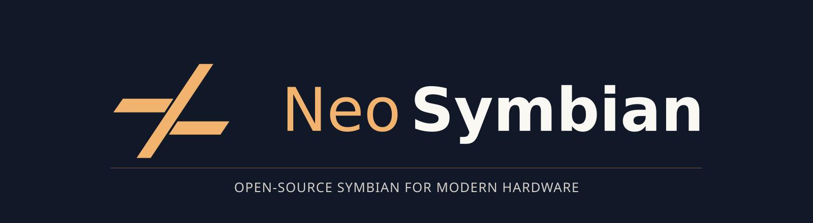

# NeoSymbian

**Open-source Symbian for modern hardware.** NeoSymbian is a volunteer, non-commercial project building on the Symbian^3 EKA2 source released in 2010.

The first target is the **Google Pixel 3a XL**; the **Pixel 3a** (same chip) has a community port too. The EKA2 kernel runs on **64-bit ARM (AArch64)**, the original 2010 Symbian user side runs in 32-bit mode, and a new touch UI written in **Rust** runs on the phone.

[Documentation](https://github.com/NeoSymbian/docs) · [Roadmap](https://github.com/NeoSymbian/docs/blob/main/roadmap.md) · [Build system](https://github.com/NeoSymbian/build) · [Kernel](https://github.com/NeoSymbian/kernel) · [Rust UI](https://github.com/NeoSymbian/neoui)

## What works today

- ✅ The 2010 SMP nanokernel boots on QEMU and on the **real phone**, on all 8 cores (GICv3, generic timer, PSCI, SMP
  load balancing).
- ✅ The standalone nanokernel test suite (nkernsa) completes on the phone, with results drawn on its screen.
- ✅ The full EKA2 kernel (flexible memory model) boots on QEMU and on the phone, on all 8 cores: kernel threads,
  the system tick and timers, and exception traps.
- ✅ User mode on the phone: 32-bit ARM Symbian code runs on the 64-bit kernel and makes system calls. The kernel
  emulates the old instructions ARMv8 dropped (SWP, misaligned LDRD/LDM).
- ✅ The real 2010 user side boots on the phone: the file server and estart with a RAM drive as C:, and the Rust
  test programs pass there (heap, timers, async, threads, semaphores, files).
- ✅ The Symbian shell (eshell) on the phone screen, drawn by the original 2010 window server.
- ✅ Input on the phone: the power and volume keys and the touchscreen (Synaptics, over I2C), with kernel drivers
  that power up what the bootloader leaves off.
- ✅ Rust runs on the 2010 Symbian user side (QEMU Syborg): EXEs written in Rust only, making kernel exec calls
  directly, with a heap, timers, async, threads and a Rust client for the file server
  ([e32-rs](https://github.com/NeoSymbian/e32-rs)).
- ✅ IPC servers in Rust: a Rust server process serves an unmodified C++ Symbian client (`RSessionBase`) and Rust
  clients, the groundwork for the Rust UI server.
- ✅ A Rust launcher UI renders through Slint's software renderer ([neoui](https://github.com/NeoSymbian/neoui)).
- ✅ The Rust launcher **replaces the window server** on the 2010 Symbian user side (QEMU Syborg): it draws straight
  to the frame buffer and takes raw touch and key events from the kernel; tapping Phone opens the Phone screen.
- ✅ Apps run as **separate Symbian processes** under the Rust UI server (QEMU Syborg): a live Clock app draws into
  a shared surface, gets touches, and exits on Back.
- ✅ The Rust UI server runs **on the phone** in place of the shell: it draws the launcher and takes taps.
- ✅ A **Terminal app** in the Rust UI runs ESHELL and the 2010 text programs (QEMU Syborg): the stock console DLL
  talks to a console server written in Rust. Taps are exact on any screen size (the emulator's pointer driver was
  fixed at the source).
- ✅ **Storage on the phone:** Symbian's own FAT32 file system on the eMMC: `C:` (8 GB, the system drive) and `E:`
  (~42 GB, mass memory) on the `userdata` partition, with long file names, TRIM and about 70 MB/s reads. Files
  survive a reboot and a forced reset. A USB debug console lets the phone be tested without anyone touching it.
- ✅ **NeoSymbian is installed on the phone and boots by itself.** The system drive `Z:` is read from flash, and
  every block is checked against SHA-256 hashes. A/B slots: a bad update falls back to the previous one on its own.
  A **Dev tools** app shows and saves the kernel's logs on the phone.
- ✅ **The Syborg emulator moved to QEMU 11.1** ([symbian-qemu](https://github.com/NeoSymbian/symbian-qemu)): the
  board rewritten in C with tests, runs natively on Apple Silicon too, VNC for live viewing, saved snapshots. Test
  runs wait for the serial log instead of fixed sleeps: the Rust test suite went from ~4 minutes to ~20 seconds.
- ✅ **A faster, steadier UI on the phone** ([smooth-ui](https://github.com/NeoSymbian/docs/blob/main/neoui-shell/smooth-ui.md) S1–S3):
  no lost taps, frames paced at 60 fps, and the fast cores at full clock (300 → 1996 MHz) while the screen is
  touched, with the UI moved onto them. Dragging went from 8 to 37–62 frames per second. Animations now copy
  already-drawn pixels instead of redrawing: the home page swipe takes 6 ms a frame, and screen fades and list
  scrolling are 2–3× faster.
- ✅ **Cellular on the phone** ([telephony](https://github.com/NeoSymbian/docs/blob/main/hardware/modem.md)): our kernel
  boots the Pixel's modem and runs its packet engine (IPA). A Rust daemon talks to the modem: it registers on
  **LTE**, the status bar shows the operator and signal bars, and calls go out and come in from the Phone screen
  with **two-way audio** on the earpiece or loudspeaker (Mute, Speaker, volume keys, keypad tones). The Pixel's
  audio DSP runs under our kernel.
- ✅ **Wi-Fi on the phone** ([wifi](https://github.com/NeoSymbian/docs/blob/main/hardware/wifi.md) W0–W7, W5a): the modem starts
  the Wi-Fi firmware, our kernel drives the WCN3990's copy engines, HTC and WMI, and **Settings → Wi-Fi lists the
  networks nearby** on 2.4 and 5 GHz. **The phone joins a WPA2 network**: our kernel does the 802.11 join, a Rust
  supplicant ([neohw](https://github.com/NeoSymbian/neohw) `wpa`) runs the key handshake, and the status bar shows
  the link. **The phone gets an IP address and reaches the internet**: NEONET, a Rust IP stack on smoltcp, gets an
  address by DHCP and gives apps TCP and UDP sockets (W5). The driver now sleeps on the chip's interrupts instead of
  polling (W7). **Unchanged 2010 programs reach the internet through the real socket API** (W5a): the 2010 socket
  server (ESOCK) runs over NEONET with no TCPIP6, using our protocol module and an always-up connection tier.
- ✅ **A system keyboard in three languages** ([neoui-shell](https://github.com/NeoSymbian/docs/blob/main/neoui-shell.md)):
  English, Armenian (phonetic) and Russian, switched with a globe key and managed in **Settings → Language &
  keyboard**. Any text field raises it, for example the Wi-Fi password. The Terminal gets an Esc, Tab and arrows row.
- ✅ **Phone and Contacts as one Rust app** ([phone](https://github.com/NeoSymbian/phone), telephony C8): NEOPHONE
  sits behind both home icons in the N8 Belle look, redrawn for the Pixel. It has a dialer with smart matching,
  Recents, call details and speed dial. The call screens cover incoming, active, call waiting, two calls with swap
  and conference, the keypad and the summary. Contacts have Latin, Armenian and Cyrillic sections, a card, an editor
  and vCards. Caller ID and call waiting work on the network, and **a blocklist** in the modem daemon rejects
  blocked callers as busy before the phone rings. Number fields bring up a phone pad.
- ✅ **Messages, NEOPHONE's third icon** (telephony C9): SMS in the modem daemon
  over QMI WMS. Armenian, Cyrillic and long texts are split into parts, ✓✓ shows delivery, and messages are kept
  even while the app is closed. Conversations, threads and new messages to several people. **Reply with message**
  answers a call with busy and a text. The blocklist covers messages too.
- ✅ **UI v2: Phone, Contacts and Messages as three apps, installed on the phone** ([phone-apps](https://github.com/NeoSymbian/docs/blob/main/phone-apps.md)):
  every app now draws its header and footer from a shared Rust kit, in the new NeoSans font (Latin and Armenian).
  Phone, Contacts and Messages are three separate programs that open each other, each with its own card in Open apps.
  Every screen of the design canvas is built and wired, including the proposals: one entry per conversation in the
  notification shade with Reply, swipe to archive, a shared settings page, and a Return to call bar in all three apps.
  Calls show a Conference screen after a merge. The home icons show missed calls and unread messages, and `*#06#`
  shows the IMEI.
- ✅ **Sound for apps** ([audio](https://github.com/NeoSymbian/docs/blob/main/hardware/audio.md)): NeoAudio, a Rust audio
  service, mixes any number of streams at any rate and plays them through the Pixel's audio DSP. It also records from
  the microphone. **Settings → Sounds → Media** sets the media volume and the speaker, and has a test sound and a
  record-and-play-back test; the volume keys set the media volume outside a call. Calls and the ringtone take over
  the speaker. **Old apps get sound too**: their unmodified 2010 audio framework talks to NeoAudio through our
  adaptor, so Frozen Bubble plays its sounds. The 3.5 mm jack has a driver.
- ✅ **Files v2** ([files-app](https://github.com/NeoSymbian/docs/blob/main/files-app.md) FA1–FA11, the
  phone): the new design's drive and folder screens; copy and move on a background thread with a progress bar in the
  notification shade; a Recycle bin per drive that survives power cuts and reboots; Recent, Favourites, a Types tab and
  search over a file index; Free up space (large files, old downloads, duplicates); Details; and a text and code
  editor with syntax colours, find and replace, Markdown preview and CSV tables, which saves files byte for byte and
  opens a 5 MB log in about a second; an image viewer with thumbnails, swipe and pinch zoom, and an editor that
  rotates, crops and resizes (JPEG, PNG, GIF, WebP, BMP, SVG; a 12 MP photo opens in about a second); zip, gzip
  and tar archives to browse, extract and create (a 1 GB zip extracts in about a minute); contact cards and calendar
  events to view and edit, with Add to Contacts; and viewers for fonts, certificates, app packages and any other
  file as hex; Open with, Share, and Files as the system file picker, with apps passing open files to each other
  by handle; WAV audio; and documents: Word (docx), OpenDocument (odt) and rtf in reflowed and page views, an e-book
  reader for EPUB (pages, contents, text size, themes, your place kept) and Excel (xlsx) sheets as a read-only grid,
  in Armenian, Russian and English, with photos loaded only as you scroll to them; and PDFs: pages, thumbnails,
  pinch zoom, contents, go to page and passwords, your place kept.
- ✅ **Clock and Calendar** ([datetime](https://github.com/NeoSymbian/docs/blob/main/datetime.md), the phone):
  a new Clock (clock with world cities, alarms, timer and stopwatch) and a Calendar (month, week, day and to-do,
  repeating events, reminders, anniversaries and your contacts' birthdays, .ics import from Files). A resident
  service, DTSRV, keeps every alarm, timer, event and to-do and rings them over any app, with the screen woken, a
  tone, Snooze and Dismiss, and a card in the notification shade; they survive a restart.
- 🚧 **Video in Files** ([files-app](https://github.com/NeoSymbian/docs/blob/main/files-app.md) FA12, the phone):
  MP4, MOV, 3GP and Matroska/WebM with H.264, VP8 and VP9 pictures and AAC, Vorbis and Opus sound, all decoded in
  pure Rust; 720p plays at about 30 fps in portrait with seek, speed, mute, rotate and full screen. Still open:
  sound and picture drift up to 0.1 s after key frames, landscape at 23–27 fps, and nothing over 720p yet.
- ✅ **A web browser** ([browser](https://github.com/NeoSymbian/docs/blob/main/browser.md), Servo): Servo draws
  real web pages, https included, in the Browser app on the phone (WB4). You can type into forms in English and
  Armenian, answer page dialogs, upload a file through Files, open pages in tabs, press and hold a link for its menu,
  find text on the page, select and copy it, and keep bookmarks, history and downloads, with scrolling at 15–18 frames
  a second (WB5). The groundwork:
  Servo 0.8 runs on emulated 32-bit ARM Linux at phone size (WB0). On the phone, the kernel now gives apps hardware
  floating point and NEON, switched per thread, plus 16 MB thread stacks and secure random numbers (WB1). Rust's
  standard library and Tokio run on the phone and fetch web pages over Wi-Fi (WB2), and Servo's JavaScript engine,
  SpiderMonkey, passes its tests on the phone: the language, garbage collection, threads and running out of memory
  cleanly (WB3).
- ✅ **The 2010 user side is built for ARMv8** ([user-side-smp](https://github.com/NeoSymbian/docs/blob/main/user-side-smp.md)
  US2 + US3): every 2010 Symbian library, server and program now compiles as 32-bit ARMv8 with hardware floating point
  and SMP-safe memory barriers, instead of ARMv5. Same exports, 1 % smaller, same boot time; old S60 apps keep
  running unchanged. Our Rust code followed (US4, 2026-11-25): real atomics, NEON, and the UI draws its home screen
  2.2× faster. The ARMv5 leftovers and the old Syborg emulator build are gone (US5): CI and the phone now build
  byte-identical system files, checked on every build. CI tests it all on QEMU's `virt` board with our kernel (US6):
  the ARMv8 CRC, AES and SHA instructions (also on both of the phone's core clusters), the multicore checks, and the
  touch UI itself, now with a screen, touch and keys that can be watched over VNC.

## Next

Emergency calls through the modem's emergency call type.

A **Settings app** of its own ([neoui-shell/settings](https://github.com/NeoSymbian/docs/blob/main/neoui-shell/settings.md#the-settings-app-neoset)): Settings
leaves the shell for `NEOSET.EXE`, so it shows in Open apps, with every page of the Settings v2 design (Wi-Fi,
mobile, sound profiles, display, battery, storage, apps, privacy, reset) in stages SE0–SE7.

Old Symbian apps ([legacy](https://github.com/NeoSymbian/docs/blob/main/legacy.md)): unmodified S60 `.sis` apps in
one shared 2010 window server inside the Rust UI. The **Old apps** screen already lists the installed apps from
Symbian's app registry, with their icons, and starts them (QEMU); next come SVG icons and getting X-plore and Frozen
Bubble through their start-up.

Sharing `E:` with a PC over USB, updates from the phone itself, and power (battery, idle, sleep)
  ([the storage plan](https://github.com/NeoSymbian/docs/blob/main/filesystem.md)).

Follow along in the [roadmap](https://github.com/NeoSymbian/docs/blob/main/roadmap.md).

## Repositories

| Repository | What |
|---|---|
| [kernel](https://github.com/NeoSymbian/kernel) | The EKA2 kernel with the AArch64 port, drivers and boards (`baseport/arm64`), in Symbian's own layout |
| [build](https://github.com/NeoSymbian/build) | The build system: `neo`, the build image, the pinned sources, the 2010 ROM |
| [e32-rs](https://github.com/NeoSymbian/e32-rs), [neoui](https://github.com/NeoSymbian/neoui) | Rust on the Symbian user side, and the Rust UI server and apps |
| [docs](https://github.com/NeoSymbian/docs) | Roadmap, Rust integration, the port map |
| [neohw](https://github.com/NeoSymbian/neohw) | The hardware's user side in Rust (was telephony + neolink): the modem, audio, Wi-Fi and IP daemons; [hardware.md](https://github.com/NeoSymbian/docs/blob/main/hardware.md) lists every driver |
| [files](https://github.com/NeoSymbian/files) | Files: the file manager (Rust + Slint), its file-operation engine, the file index, the text, code and table formats and the image formats |
| [phone](https://github.com/NeoSymbian/phone) | Phone, Contacts and Messages: the NEOPHONE app (Rust + Slint), its contacts model, call and message logic |
| [legacy](https://github.com/NeoSymbian/legacy) | Old S60 apps inside the Rust UI: LEGACY.EXE (the guest window server and the Old apps launcher), the legacy component list and `.sis` tools |
| [browser](https://github.com/NeoSymbian/browser) | The web browser: Servo on NeoSymbian (the armv7 host proof, the embedder, measurements) |
| [symbian-qemu](https://github.com/NeoSymbian/symbian-qemu) | The Syborg board package: the baseport, QEMU 11.1 with the Syborg board, the test runner |
| `oss.*` | The 2010 Symbian packages the build pins, forked from [SymbianSource](https://github.com/SymbianSource) |

Archived: `symbian-pixel` (the port's first home), and the Phorepoc forks (`core`, `pdk`, `adaptation-*`) with the
`oss.*` packages only they used.

In every fork, the original branches stay untouched and our work is on `main`. Nothing is pushed back upstream.

## Credits and licences

- Symbian source: Nokia and the Symbian Foundation, EPL-1.0, via [SymbianSource](https://github.com/SymbianSource).
- The first build system, the x86-64 port template and many fixes for modern compilers: [Phorepoc](https://github.com/Phorepoc), Apache-2.0.
- Our own code: Apache-2.0.

NeoSymbian is not affiliated with Nokia, Accenture, the former Symbian Foundation, or Google. "Symbian" is used only to
describe the software this project builds on.
